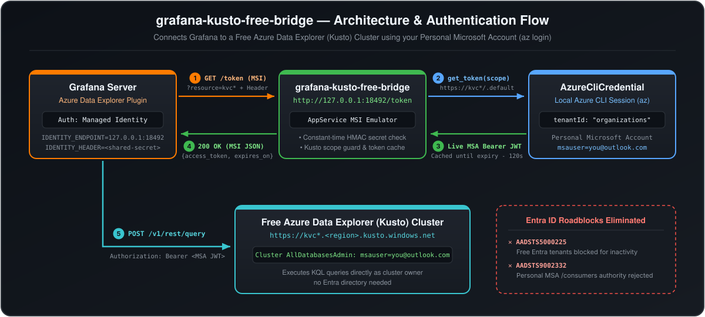

# grafana-kusto-free-bridge

**Connect Grafana to a Free Azure Data Explorer (Kusto) cluster using a personal Microsoft Account (`@outlook.com`, `@hotmail.com`, `@live.com`), without Entra ID tenants, App Registrations, or expiring Client Secrets.**

---

## The Problem

Microsoft offers a [Free Azure Data Explorer (Kusto) cluster](https://dataexplorer.azure.com/freecluster) (`https://kvc*.kusto.windows.net`) that anyone can create using a personal Microsoft Account (`msauser=...`) without an Azure subscription or credit card.

However, when you try to connect **Grafana** (`grafana-azure-data-explorer-datasource`) to a Free Kusto cluster, you hit three roadblocks:

1. **No Personal Microsoft Account Login in Grafana:** 
Grafana's Azure Data Explorer plugin only supports corporate **Microsoft Entra ID** authentication (`App Registration`, `Managed Identity`, or `Workload Identity`).
2. **`AADSTS9002332` (`/consumers` Endpoint Rejected):**
 Personal Microsoft Accounts live in the consumer tenant (`9188040d-6c67-4c5b-b112-36a304b66dad`), which Azure Data Explorer rejects for OAuth2 application flows.
3. **`AADSTS5000225` (Free Entra ID Tenants Blocked for Inactivity):** 
If you create a free Microsoft Entra ID tenant (`*.onmicrosoft.com`) to host an App Registration (`Client ID` + `Client Secret`) for Grafana, Microsoft's automated [Tenant Lifecycle Policy](https://aka.ms/TenantLifecycle) eventually freezes the tenant due to lack of active billing subscriptions (`AADSTS5000225: This tenant has been blocked due to inactivity`) and permanently deletes it 20 days later.

---

## How `grafana-kusto-free-bridge` Solves It



`grafana-kusto-free-bridge` runs a lightweight, multi-threaded loopback HTTP service (`127.0.0.1:18492/token`) that emulates the standard **Azure App Service Managed Identity** protocol (`IDENTITY_ENDPOINT` + `IDENTITY_HEADER`).

When Grafana requests a token for your Kusto cluster, the bridge acquires and caches a live token from your local Azure CLI session (`AzureCliCredential`) using your personal Microsoft Account (`msauser=you@outlook.com`), which is already the native owner (`AllDatabasesAdmin`) of your Free Kusto cluster.

---

## Security & Performance Features

* **Kusto-Only Scope Restriction:** Only issues tokens for valid HTTPS Azure Data Explorer / Kusto cluster endpoints (`*.kusto.windows.net`, `*.kusto.azuresynapse.net`, `*.kusto.fabric.microsoft.com`, etc., or explicit `--allowed-resource` URIs). Requests for `management.azure.com` or `graph.microsoft.com` are rejected with `400 Bad Request`.
* **Constant-Time Secret Validation:** Validates `X-IDENTITY-HEADER` using `hmac.compare_digest` and refuses to bind to non-loopback interfaces (`0.0.0.0`) unless a custom secret is configured.
* **Thread-Safe Per-Scope Token Caching:** Uses `ThreadingHTTPServer` and per-scope locks to cache acquired tokens until 2 minutes before expiry, avoiding spawning an `az` subprocess on concurrent Grafana dashboard panel queries.
* **Safe Atomic Profile Repair:** `--fix-az-profile` creates a `.bak` backup, preserves file permissions, and atomically updates `~/.azure/azureProfile.json` (`utf-8-sig`) to fix personal MSA consumer tenant issues (`AADSTS9002332`).

---

## Prerequisites

1. **Python 3.10+** (or [`uv`](https://docs.astral.sh/uv/) for zero-install execution)
2. **Azure CLI (`az`)** logged in with your personal Microsoft Account via the `organizations` pass-through authority:
   ```bash
   az login --tenant organizations --allow-no-subscriptions
   ```

---

## Quick Start

### Step 1: Verify & Fix Your Local Azure CLI Profile

Run the built-in `--fix-az-profile` check to ensure `~/.azure/azureProfile.json` uses `"tenantId": "organizations"` (avoiding `AADSTS9002332`) and can acquire a Kusto token:

```bash
uv run grafana_kusto_free_bridge.py --fix-az-profile --default-resource https://kvcYOURCLUSTER.northeurope.kusto.windows.net
```

### Step 2: Run the Token Bridge

```bash
uv run grafana_kusto_free_bridge.py
```

By default, the bridge listens on `http://127.0.0.1:18492/token` and requires the header `X-IDENTITY-HEADER: kusto-local-bridge`.

### Step 3: Enable Managed Identity in Grafana

1. In `grafana.ini`, enable Managed Identity under the `[azure]` section:
   ```ini
   [azure]
   managed_identity_enabled = true
   ```
2. Pass the two standard Azure App Service Managed Identity environment variables to the Grafana server process:
   ```bash
   export IDENTITY_ENDPOINT="http://127.0.0.1:18492/token"
   export IDENTITY_HEADER="kusto-local-bridge"
   ```
3. In the Grafana UI (**Connections -> Data sources -> Azure Data Explorer**):
   - **Authentication Method:** `Managed Identity`
   - **Default cluster URL:** `https://kvcYOURCLUSTER.<region>.kusto.windows.net/`
   - Click **Save & test**.

> [!NOTE]
> When clicking **Save & test**, Grafana will display a green checkmark:
> `Success connecting to Azure Data Explorer, but unable to connect to Azure Resource Graph to get clusters: failed to retrieve Azure access token: ManagedIdentityCredential authentication failed... RESPONSE 400: 400 Bad Request ... "error": "invalid_resource"`.
> This is completely normal: Free Kusto clusters do not reside inside an Azure subscription (Resource Graph), and the bridge intentionally restricts token issuance to Kusto cluster endpoints (`*.kusto.windows.net`), rejecting `management.azure.com` Resource Graph queries with `400 invalid_resource`. Your configured **Default cluster URL** is used directly.

---

## Running as a Background Service

### macOS (Homebrew + `launchd`)

1. Copy [`examples/macos/com.grafana.kusto-free-bridge.plist`](examples/macos/com.grafana.kusto-free-bridge.plist) to `~/Library/LaunchAgents/` and update the paths for your username.
2. Set the environment variables for `launchd` and load the service:
   ```bash
   launchctl setenv IDENTITY_ENDPOINT "http://127.0.0.1:18492/token"
   launchctl setenv IDENTITY_HEADER "kusto-local-bridge"
   launchctl bootstrap gui/$(id -u) ~/Library/LaunchAgents/com.grafana.kusto-free-bridge.plist
   brew services restart grafana
   ```

### Linux (`systemd`)

1. Install [`examples/linux/grafana-kusto-free-bridge.service`](examples/linux/grafana-kusto-free-bridge.service) to `/etc/systemd/system/` (updating `YOUR_USERNAME`) and enable it (`sudo systemctl enable --now grafana-kusto-free-bridge`).
2. Add the Managed Identity environment variables to `grafana-server.service` via `sudo systemctl edit grafana-server.service`:
   ```ini
   [Service]
   Environment="IDENTITY_ENDPOINT=http://127.0.0.1:18492/token"
   Environment="IDENTITY_HEADER=kusto-local-bridge"
   ```
   Then restart Grafana (`sudo systemctl restart grafana-server`).

---

## CLI Options & Environment Variables

| Flag | Environment Variable | Default | Description |
| :--- | :--- | :--- | :--- |
| `--host` | `BRIDGE_HOST` | `127.0.0.1` | Bind address for the HTTP server |
| `--port` | `BRIDGE_PORT` | `18492` | Bind port for the HTTP server (`1-65535`) |
| `--secret` | `IDENTITY_HEADER` | `kusto-local-bridge` | Shared secret required in `X-IDENTITY-HEADER` (custom secret required on non-loopback hosts) |
| `--default-resource` | `DEFAULT_KUSTO_RESOURCE` | `https://help.kusto.windows.net` | Fallback Kusto resource URI if omitted in query string |
| `--allowed-resource` | – | *(built-in Kusto suffixes)* | Additional exact HTTPS resource URI(s) to allow (repeatable) |
| `--doctor` | – | `false` | Validate `~/.azure/azureProfile.json` and test token acquisition |
| `--fix-az-profile` | – | `false` | Repair `"tenantId": "organizations"` and default account in `~/.azure/azureProfile.json` (creates `.bak`), run `--doctor`, and exit |

---

## Running Tests

```bash
uv run --with pytest pytest
```

---

## License

[MIT License](LICENSE) — Copyright (c) 2026 Rolf Greven.
